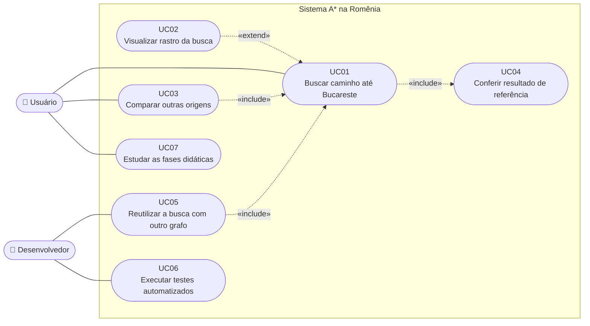

# 2. Casos de Uso

## 2.1 Atores

| Ator | Descrição |
|------|-----------|
| **Usuário** | Estudante ou avaliador que executa o programa e lê o resultado. |
| **Desenvolvedor** | Quem reaproveita a função `busca_a_estrela` com outros dados ou roda os testes. |

## 2.2 Diagrama de casos de uso

## 2.3 Especificação dos casos de uso

### UC01 — Buscar caminho até Bucareste

| Campo | Descrição |
|-------|-----------|
| **Ator** | Usuário |
| **Requisitos** | RF03, RF04 |
| **Pré-condição** | A cidade de origem existe no mapa e tem valor em `h(n)`. |
| **Pós-condição** | O caminho de menor custo e o custo total são exibidos. |

**Fluxo principal**

1. O usuário executa `python a_estrela.py`.
2. O sistema carrega o mapa e a heurística.
3. O sistema cria a fronteira com o nó da origem.
4. O sistema retira da fronteira o nó de menor `f`.
5. Se a cidade do nó é Bucareste, vai para o passo 8.
6. O sistema marca a cidade como explorada e gera um nó para cada vizinho não explorado, calculando `g`, `h` e `f`.
7. O sistema volta ao passo 4.
8. O sistema exibe o caminho, o custo em km e o número de passos.

**Fluxo alternativo A — sem caminho (RF06)**

- No passo 4, se a fronteira está vazia, o sistema devolve `(None, infinito)` e exibe "Não foi possível encontrar um caminho."

**Fluxo alternativo B — nó repetido (RN05)**

- No passo 4, se a cidade do nó retirado já foi explorada, o sistema descarta o nó e retorna ao passo 4.

### UC02 — Visualizar rastro da busca

| Campo | Descrição |
|-------|-----------|
| **Ator** | Usuário |
| **Requisitos** | RF05 |
| **Pré-condição** | A busca é executada com `mostrar=True` (padrão do programa principal). |
| **Pós-condição** | Cada iteração foi impressa. |

**Fluxo principal**

1. A cada nó expandido, o sistema imprime a iteração, a cidade e os valores `g(n)`, `h(n)` e `f(n)`.
2. Em seguida, imprime a fronteira ordenada por `f`, no formato `cidade(f)`.

**Extensão:** com `mostrar=False`, nada é impresso.

### UC03 — Comparar outras origens

| Campo | Descrição |
|-------|-----------|
| **Ator** | Usuário |
| **Requisitos** | RF04 |
| **Pós-condição** | É exibida uma linha por origem com custo e caminho. |

**Fluxo principal:** para Timisoara, Oradea, Craiova e Iasi, o sistema executa UC01 sem rastro e imprime o custo e o caminho.

### UC04 — Conferir resultado de referência

| Campo | Descrição |
|-------|-----------|
| **Ator** | Usuário |
| **Requisitos** | RF08 |

**Fluxo principal:** após a busca de Arad a Bucareste, o sistema compara o resultado com 418 km e 4 passos e imprime "Conferido" ou "ATENÇÃO".

### UC05 — Reutilizar a busca com outro grafo

| Campo | Descrição |
|-------|-----------|
| **Ator** | Desenvolvedor |
| **Requisitos** | RF07 |
| **Pré-condição** | O grafo é um dicionário `cidade -> [(vizinho, custo)]` e a heurística é um dicionário `cidade -> h`. |

**Fluxo principal:** o desenvolvedor importa `busca_a_estrela`, passa origem, destino, grafo e heurística, e recebe `(caminho, custo)`.

### UC06 — Executar testes automatizados

| Campo | Descrição |
|-------|-----------|
| **Ator** | Desenvolvedor |
| **Requisitos** | RF01–RF08, RNF01–RNF03 |

**Fluxo principal:** o desenvolvedor executa `python -m unittest discover -s tests -v` e o sistema informa o resultado dos 20 casos de teste.

### UC07 — Estudar as fases didáticas

| Campo | Descrição |
|-------|-----------|
| **Ator** | Usuário |
| **Requisitos** | RNF03 |

**Fluxo principal:** o usuário executa, em ordem, `fase1 explorar.py` a `fase5_busca.py`, vendo a cada fase um conceito a mais (dados, custos, fronteira, expansão, laço de busca).
