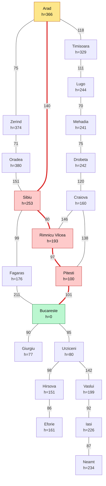
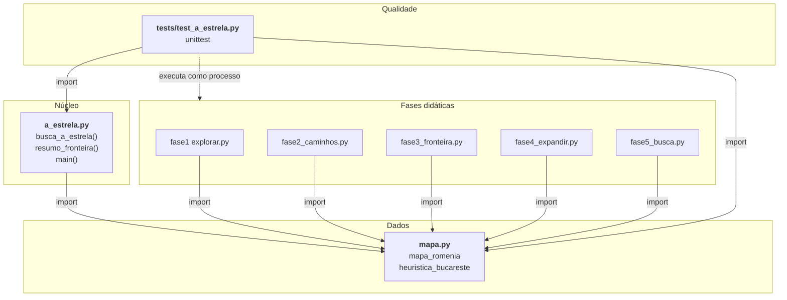
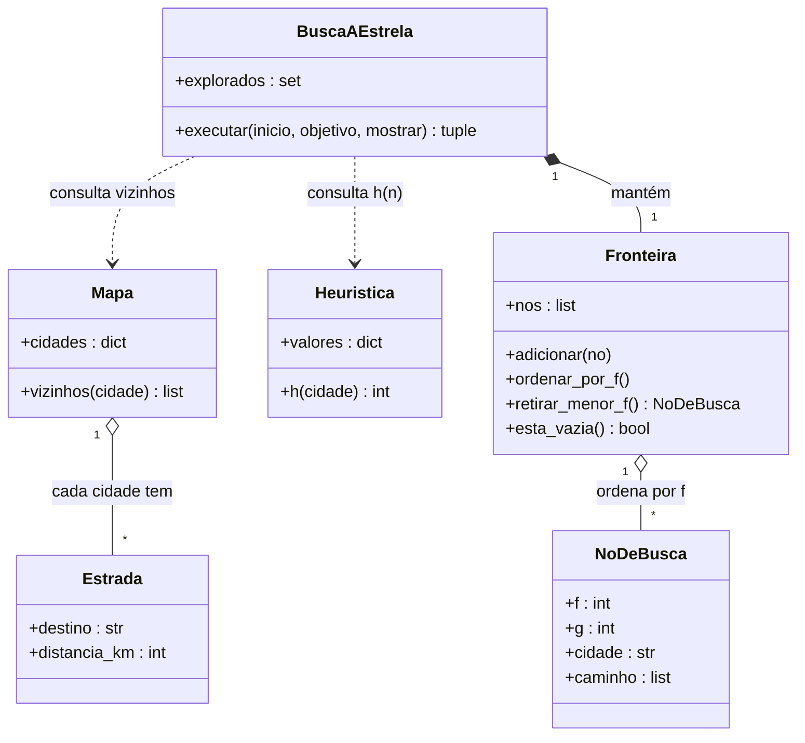
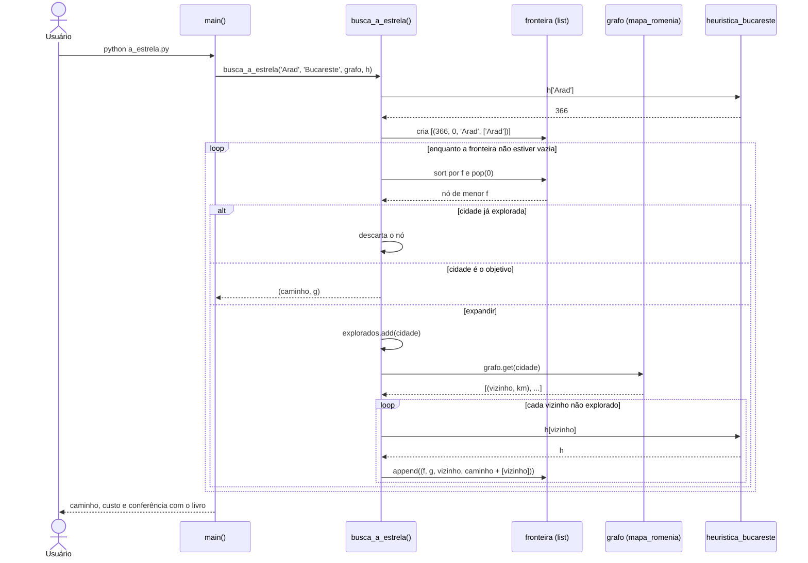
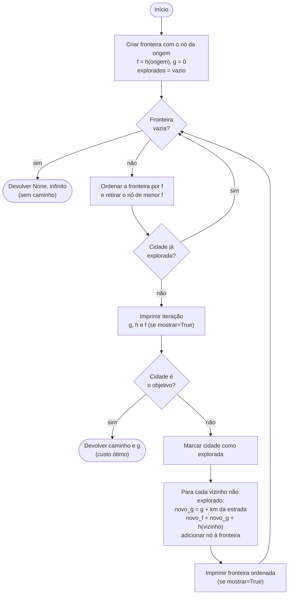
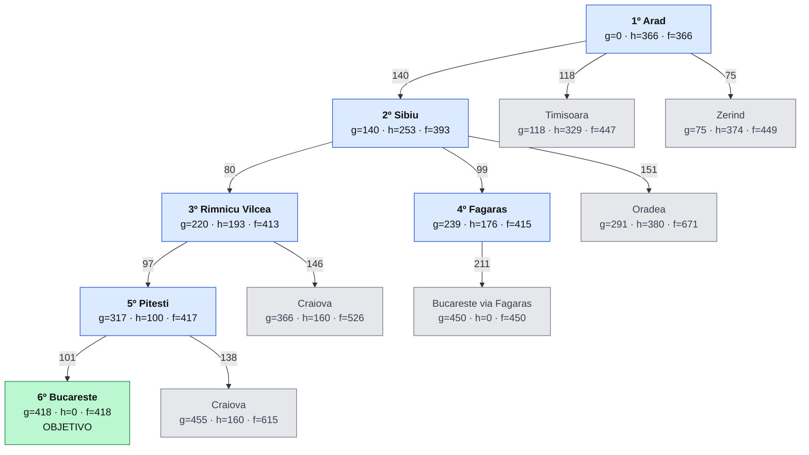

# 3. Modelagem e Diagramas

Os diagramas estão em [Mermaid](https://mermaid.js.org/), que o GitHub renderiza direto neste arquivo. Versões em imagem estão em [`img/`](img/).

| # | Diagrama | Responde a |
|---|----------|------------|
| 3.1 | Grafo do problema | Qual é o mapa e qual é o caminho ótimo? |
| 3.2 | Componentes (módulos) | Quais arquivos existem e quem depende de quem? |
| 3.3 | Classes (modelo conceitual) | Quais conceitos o domínio tem e como se relacionam? |
| 3.4 | Sequência | Como as partes conversam durante uma busca? |
| 3.5 | Atividades (fluxograma do A\*) | Qual é a lógica passo a passo do algoritmo? |
| 3.6 | Árvore de busca | O que o A\* fez de fato de Arad a Bucareste? |

## 3.1 Grafo do problema

Cada cidade mostra o valor de `h(n)` (km em linha reta até Bucareste). Cada aresta mostra a distância da estrada em km. O caminho ótimo de Arad a Bucareste está em vermelho.

## 3.2 Diagrama de componentes

O módulo `mapa.py` só guarda dados e não imprime nada. Por isso os testes e todas as fases podem importá-lo sem efeito colateral.

## 3.3 Diagrama de classes (modelo conceitual)

O código é escrito de forma funcional, com dicionários, tuplas, listas e conjuntos, o que combina com o objetivo didático. O diagrama abaixo é o **modelo conceitual** do domínio: ele mostra os conceitos e a tabela logo depois diz como cada um aparece no código.

| Conceito | Representação no código |
|----------|-------------------------|
| `Mapa` | `mapa_romenia`: `dict` de `cidade -> [(vizinho, km), ...]` |
| `Estrada` | Tupla `(cidade_vizinha, distancia_km)` |
| `Heuristica` | `heuristica_bucareste`: `dict` de `cidade -> km em linha reta` |
| `NoDeBusca` | Tupla `(f, g, cidade, caminho)`, com `f` na posição 0 para ordenar |
| `Fronteira` | `list` de nós, reordenada por `f` a cada iteração |
| `explorados` | `set` de cidades já expandidas |
| `BuscaAEstrela` | Função `busca_a_estrela(inicio, objetivo, grafo, heuristica, mostrar)` |

## 3.4 Diagrama de sequência

Fluxo de `python a_estrela.py`, de Arad a Bucareste.

## 3.5 Diagrama de atividades (fluxograma do A\*)

## 3.6 Árvore de busca (Arad → Bucareste)

O número antes do nome é a ordem de expansão. Nós em cinza foram gerados mas nunca expandidos, porque o A\* achou Bucareste com `f = 418` antes de precisar deles. Craiova e Bucareste aparecem duas vezes, por caminhos diferentes. Arad não volta a ser gerada a partir de Sibiu, porque já está em `explorados`.

Note o nó "Bucareste via Fagaras" (`f = 450`): ele foi gerado na 4ª iteração, mas só seria retirado da fronteira depois do nó `f = 418`. É por isso que o teste de objetivo é feito ao **retirar** o nó, e não ao gerá-lo (RN04).
